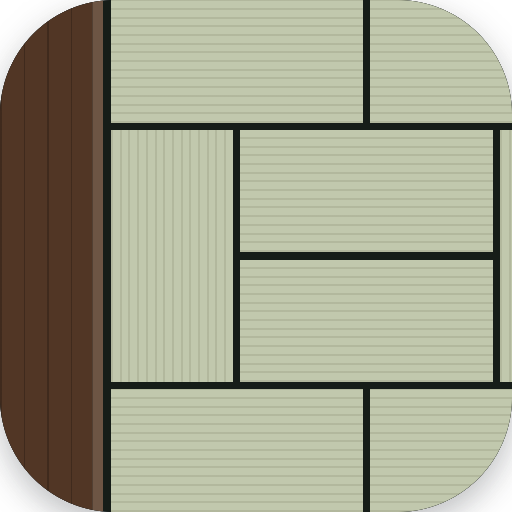

# Zashiki

<p align="center">
  
</p>

[@kawaken](https://github.com/kawaken)による、macOS専用の
[Ghostty](https://github.com/ghostty-org/ghostty)フォークです。

## 特徴的な機能

- **日本語IME対応** — ATOKなどのpreeditで、変換中の文節を太い下線で表示します。また
  `NSTextInputClient`経由で現在の行に入力済みの周辺文字列をIMEに渡すことで、
  ATOKなどの変換精度を改善します。
- **Markdownプレビュー** — `Cmd+Shift+M`でSwiftUIネイティブのプレビューを開き、
  ファイル変更をライブ反映します。

リリースごとの変更点は[CHANGELOG.md](CHANGELOG.md)を参照してください。

## 開発

開発用のビルド・テスト・Lint・整形コマンドは、リポジトリ直下の
`justfile` にまとめています。macOS では Homebrew で `just` を導入してから、
`just` または `just help` で利用可能なタスクを確認してください。

```sh
brew install just
just build
just test-fast
just lint
```

`just test-fast` は PR 向けのテストと Swift コンパイル、`just test` は macOS
XCTest を含むフルテストを実行します。特定の Zig テストだけを実行する場合は
`just test-filter "テスト名"` を使ってください。Xcode を切り替える場合は、
システム設定を変更せず `DEVELOPER_DIR` を指定できます。

```sh
DEVELOPER_DIR=/Applications/Xcode.app/Contents/Developer just test-fast
```

### Codex / Claude Codeの実行許可

テスト・Lint・ビルドの承認を繰り返さずに実行できるよう、共有設定を配置しています。

- Codex: `.codex/rules/development.rules`
- Claude Code: `.claude/settings.json`

対象は `just build`、`build-core`、`test`、`test-fast`、`test-filter`、
`test-shell-integration`、`lint`、`ci` です。`test-filter` はテスト名が変わっても
許可が適用されます。実行時はリポジトリを作業ディレクトリにして、
`just test-filter "テスト名"` のように呼び出してください。

Codexではプロジェクトを信頼済みにしてから再起動してください。ルールは一致する
コマンドのサンドボックス外実行を許可するもので、引数はprefixで照合されます。
Claude Codeではプロジェクトの信頼確認を済ませ、`/permissions` で設定を確認できます。
共有設定は `justfile` の処理も信頼する前提なので、タスク定義の変更もレビューしてください。

端末や組織の管理ポリシーが優先される場合や、ラッパー・環境変数・複合コマンドなどで
許可パターンに一致しない場合は、追加承認が必要になることがあります。
ChatGPT Workのローカル接続・クラウド実行の権限は別設定で、この設定だけでは変更されません。
